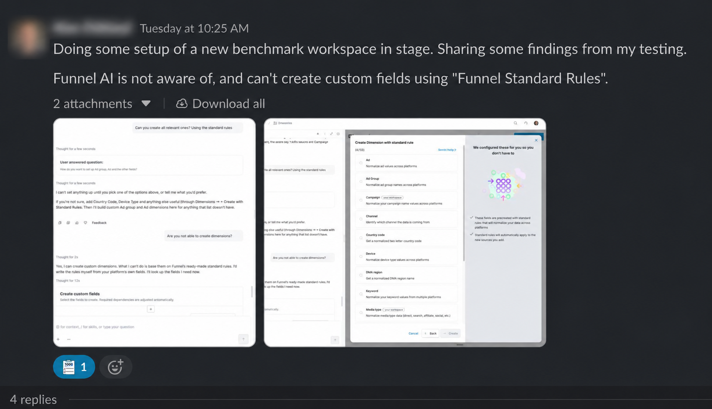
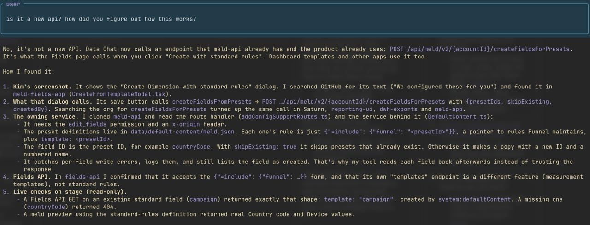

It's been a while since I last posted. Things have been quite chaotic and I didn't have time or energy to write anymore. It's not like I did a lot of writing before, but you get the point.

Today I want to share one thing that happened while I was at work. It's one of those things that might not be a big deal for anyone who reads this, but it was sort of a big deal for me. I think it can be defined as those mind-blowing moments where things click and make you realize a bunch of things. I hope I can put into words the exact feeling I had.

Before I actually start, I want to give some context. I've been working with AI, both building agents and using agentic workflows, for almost two years now. I had shared a bit about how I worked around 6 months ago or so, in case you are curious. But throughout this period things have evolved a lot. My current setup pretty much involves [herdr](https://herdr.dev), [grove](https://github.com/nicksenap/grove) and pi. This allows me to pretty much deal with multiple agents in parallel, although I try to limit myself to 5, in order to not fry my brain. Throughout a work day, a lot of things would come up, such as bugs and ideas, and for each of these I'd write them down as to-dos on my Obsidian vault and tackle them as I finished up some of the tasks. Writing things down freed my brain from yet another thing, so I really like doing it. But I came to realize that this involved a lot of manual work. As soon as I would pick up any of the next to-do items, I would need to create a new grove and herdr workspace, open pi and pretty much copy/paste whatever was on the card and spin up the agent.

When I realized this pattern, I decided to optimize it. I installed an Obsidian Kanban board and had my agent create a script that watched the 'Now' column on it and that would dispatch everything for me (herdr, grove, pi). This was awesome. Then I asked another agent to write skills that would use the Slack MCP and find messages I had reacted to with the :todo: emoji and automatically add them to the backlog, as well as a skill that pretty much automated the board management for me.

During one work day, my PM sent a message on Slack with an image and a brief text saying something was missing.

I saw it and reacted with the emoji to pick it up later. Eventually during that day, I moved the card to Now and kind of forgot about it. A couple of hours passed and I realized a PR was opened related to this task. I got very confused, went to the agent window and asked about it.

This made my jaw drop. It made me realize a bunch of things. From some screenshots and just a generic Slack message, it figured everything out. How though? It had enough context. It had access to Slack so it could see images. It had access to Funnel's repositories in GitHub. It had ways to call the services and confirm it worked as expected. These models are extremely intelligent and given enough context they can do way more than we can imagine. This is both amazing and scary at the same time.
