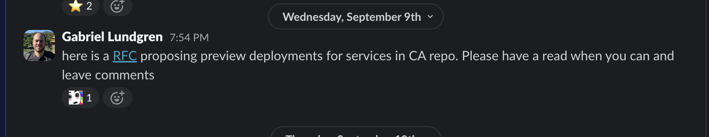

In this post, I’ll try to describe what my team has learned over the past few months.

But before going into details, let me briefly describe what my current team at Funnel actually works on. We’re responsible for all user-facing AI products, including Funnel AI, our conversational, agentic AI assistant that allows teams to analyze performance and get work done simply by asking, as well as Funnel’s MCP server, which allows pretty much anyone to connect their own harnesses or agents to Funnel.

There’s been lots of talk about feedback loops, context engineering and finding the next bottleneck. And to be quite honest, I think all of it is actually worth spending time on. My team has spent lots of time trying to get rid of or optimize steps that were consuming our time.

One of the first bottlenecks we faced was that every change we made to our agents meant we had to go and talk to Funnel AI ourselves, either to reproduce the issue or to see if our changes actually worked. So my brilliant colleague [Nick Song](https://nicksenap.github.io/) spent lots of time building a custom CLI tool that allows our agents to run Funnel AI in headless mode. Now, instead of us needing to test things ourselves, our agents can do it.

This was a huge improvement. But as soon as we fixed that, another bottleneck became obvious.

We are a team of about 10 people, and in this AI era, almost everyone on the team is now able to write code and make changes. We encourage that a lot, so even our designers and product managers are opening PRs almost every day. As great as this is, it was becoming yet another bottleneck. You might think it’s because of code reviews, but that wasn’t the only problem.

At Funnel, we work with three separate environments: one staging and two production. Even though we could test things locally, that wasn’t ideal, because as we added more and more capabilities to our product, we started relying on other parts of the application. This meant we needed to deploy things to staging in order to test them properly. And this became a big bottleneck. Our internal Slack channel turned into more or less a reservation system, where people would write, “I need to test things on staging. Please don’t merge anything.”

So I spent some time optimizing this. I made it possible for every feature branch to get its own isolated, staging-based preview instance. This sped things up immensely.

Of course, there are still cases where we test things ourselves, but now our agents can test their own changes in headless mode against an isolated preview deployment. This gives us much more confidence that what we ship actually works as expected.

None of this means everything works out smoothly. Trust me, it doesn’t. But it’s amazing to see how much velocity we’ve gained just by spending time giving our agents proper tooling. 

And honestly, the biggest improvements haven’t come from making our agents better at writing code, but from building the tools that let them work more on their own. There are still a lot more problems to solve, and once we solve them, I’ll try to share what we learned here.  